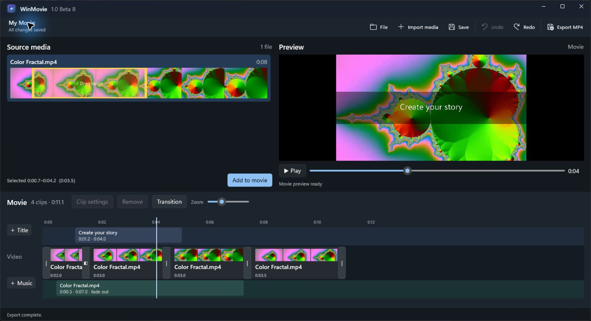

# WinMovie

A native Windows video editor inspired by the fast, simple editing flow of iMovie '08–'11: skim footage, select ranges, and build your movie.

Current preview: **v1.0-beta.8**. The next feature iteration is beta 9. Releases remain betas until the maintainer chooses a release candidate or stable version.



## Make a movie

1. **Import media.** Hover over a filmstrip to skim. Drag across frames to select a range; adjust its yellow edges for precision.
2. **Add your selection.** Drag the yellow range into the movie or choose **Add to movie**. Drag clips to reorder them. Right-click a clip for settings, keyboard-accessible reordering, or removal.
3. **Refine the edit.** All three tracks share a ruler, zoom level, and horizontal scroll position. Click the ruler to seek. Click a transition marker to choose an illustrated transition and its duration. Ctrl-click clips or Ctrl+A in the movie to change shared settings.
4. **Add titles and music.** Titles sit above video; music sits below it. Drag either to change its start time. Titles have live previews, installed fonts, RGB/HEX color pickers, adjustable shadow and outline, and fades. Apply and Cancel stay visible while editing. Switching to another clip applies title edits; Undo can restore them.
5. **Save and export.** Saved projects autosave every 30 seconds after edits. Unsaved changes prompt before closing, starting a new movie, or opening another project. Export MP4 offers source-limited sizes from 480p to 4K, detects a working hardware encoder, and shows progress and cancellation. Open the completed MP4 in your default player or open its folder.

**Clip settings** contains source trim, a speed percentage with a duration comparison and keep-pitch option, volume up to 4×, normalization, and fades. Titles and music have independent start times and durations. Older clip titles become independent title items when a project is opened.

Source files remain linked by path. If a video moves, right-click its missing media card and choose **Locate file**. Exports cannot overwrite files linked into the movie.

## Keyboard controls

| Shortcut | Action |
| --- | --- |
| Ctrl+I / Ctrl+O / Ctrl+N | Import video / open project / new movie |
| Ctrl+S | Save project |
| Ctrl+Z | Undo an edit; text fields retain their native text undo |
| Ctrl+Shift+Z or Ctrl+Y | Redo |
| Space | Play/pause the movie, or play source footage from the hovered position |
| E | Add the current source range |
| Ctrl-click / Ctrl+A | Select multiple clips / all movie clips |
| Delete | Remove selected clips, title, music, or transition; editable fields retain normal text deletion |

## Build and run

Requires Windows 10 2004 or later (Windows 11 recommended), the [.NET 8 SDK](https://dotnet.microsoft.com/download/dotnet/8.0), and [FFmpeg](https://ffmpeg.org/download.html) with `ffmpeg` and `ffprobe` on `PATH`. WinMovie uses Windows App SDK 1.8 and runs as an unpackaged, self-contained WinUI 3 application.

```powershell
dotnet restore WinMovie.csproj
dotnet run --project WinMovie.csproj -p:Platform=x64
```

Build a distributable folder:

```powershell
dotnet publish WinMovie.csproj -c Release -r win-x64 --self-contained true -p:Platform=x64
```

Keep the complete publish folder together, including `WinMovie.pri` beside `WinMovie.exe`. FFmpeg is a separate runtime dependency. Windows x64 ZIP builds are attached to GitHub Releases.

Run the smoke and regression checks:

```powershell
dotnet run --project tests/WinMovie.ExportSmoke.csproj
```

See the [beta 8 debugging notes](docs/BETA8-ENGINEERING.md) for the failure causes, fixes, and verification scope.

## Current limits

Movie previews use a background render at 480p; edits can require a short wait before complete playback is ready. Unchanged clip segments are cached. Export is H.264/AAC MP4 at 30 fps with stereo 48 kHz audio. The app probes NVIDIA, Intel, and AMD encoders and falls back to software. There is no effects browser, still-image clip support, or media embedding in project files yet.
