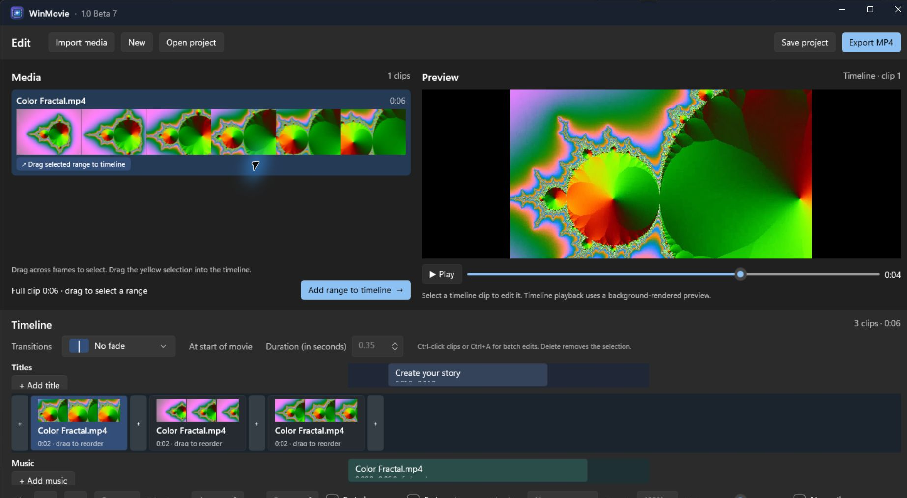

# WinMovie

A small, native WinUI 3 video editor built around the quick editing flow of iMovie '08–'11.

Current preview: **v1.0-beta.7**. The next feature iteration will be beta 8; release candidates and the stable release will be named when the maintainer decides they are ready.



## What works

- Import MP4, MOV, MKV, AVI, M4V, and WebM video through a file picker.
- Each imported clip has a six-frame filmstrip in the upper-left media bin. Hover to skim, drag across it to select a range, or drag a yellow edge to refine the range. Drag the yellow selection itself onto the timeline, or use the Add button. The same source can be used repeatedly.
- Timeline clips show filmstrip previews. Drag a clip to the highlighted insertion point to reorder it, or use the arrow buttons. Ctrl-click clips or press Ctrl+A while the timeline is active to select multiple clips for shared settings or deletion. Trimming applies to the primary clip.
- Click a timeline boundary and choose Cut, Dissolve, Fade through Black/White, Wipe Left/Right, or Slide Left/Right from the illustrated menu. Set its duration in seconds. Press Delete to clear a selected transition or remove a selected clip.
- Add independent titles on the compact track above the main timeline, set start and duration, drag to change timing, and choose placement, any installed font, text/background colors through RGB/HEX pickers, opacity, adjustable blurred shadow, pixel outline, and fade in/out. Titles can span clip boundaries. The title editor stays alongside the video and previews changes with the same font rendering used for export. Its text field spell checks as you type. Click the title in the preview to edit its text. New titles start at the timeline playhead and last five seconds by default. Existing clip titles remain supported.
- Add background music on the compact track below the main timeline, set its timeline start, source trim, volume, and optional fade out. Drag its card to change its start time.
- Set clip volume from 0 to 4×, normalize audio, and enter a speed percentage from 25% to 400% in a dialog that compares original and new duration and offers a keep-pitch choice.
- Press Space over a source filmstrip to play from the hovered frame and press it again to pause. With the timeline active, Space plays or pauses it; key repeat is ignored and Space is handled before focused buttons. Save and reopen `.winmovie` projects. WinMovie prompts to save or discard changes before closing, starting a new movie, or opening another project; saved projects autosave every 30 seconds when changed. Timeline playback uses a low-resolution background render that includes transitions, titles, music, speed, fades, and audio processing. Unchanged clip segments are cached between previews, and the app tries a detected hardware encoder first.
- Export H.264/AAC MP4 at a chosen size from 480p through 4K, limited by the smallest source video in the timeline. The app probes NVIDIA, Intel, and AMD encoders and chooses an available hardware encoder automatically, with software fallback. The suggested filename matches a saved project's name. A modal progress overlay supports cancellation; when export finishes, open the MP4 in your default player or open its folder.

Source files remain in place, so moving them will break a saved project's media links.

## Build and run

Requires Windows 10 2004 or later (Windows 11 recommended), the [.NET 8 SDK](https://dotnet.microsoft.com/download/dotnet/8.0), and [FFmpeg](https://ffmpeg.org/download.html) with `ffmpeg` and `ffprobe` on `PATH`. The project uses Windows App SDK 1.8 and builds as an unpackaged, self-contained WinUI 3 app.

```powershell
dotnet restore WinMovie.csproj
dotnet run --project WinMovie.csproj -p:Platform=x64
```

For a distributable folder:

```powershell
dotnet publish WinMovie.csproj -c Release -r win-x64 --self-contained true -p:Platform=x64
```

The output is under `bin/x64/Release/net8.0-windows10.0.19041.0/win-x64/publish/`. FFmpeg is a separate runtime dependency; put its executables on `PATH` on the target PC.

Keep the complete publish folder together when distributing the app. In particular, `WinMovie.pri` must sit beside `WinMovie.exe`; the project checks for it during publish.

## Editing flow

1. Import one or more videos.
2. Skim an imported video's filmstrip and drag to highlight a range. Drag inside the yellow range to a timeline card or `+` boundary, or click **Add range to timeline**.
3. Drag timeline clips to reorder them. Click a boundary for the transition menu and duration. Ctrl-click or Ctrl+A to apply shared settings. Add titles and music on their own tracks; click their cards for timing and style controls, or drag them to change their start time. Use Delete on selected clips, a title, music, or a transition.
4. Let the timeline preview finish rendering in the background, then play it. Save the project and use **Export MP4** to pick a source-limited resolution.

### Current limits

There is no effects browser or image clip support yet. Timeline preview is rendered at 480p and still has to join clips when transitions, titles, or music change. Export uses 30 fps and stereo 48 kHz audio. Music and source media remain linked by their file paths.
